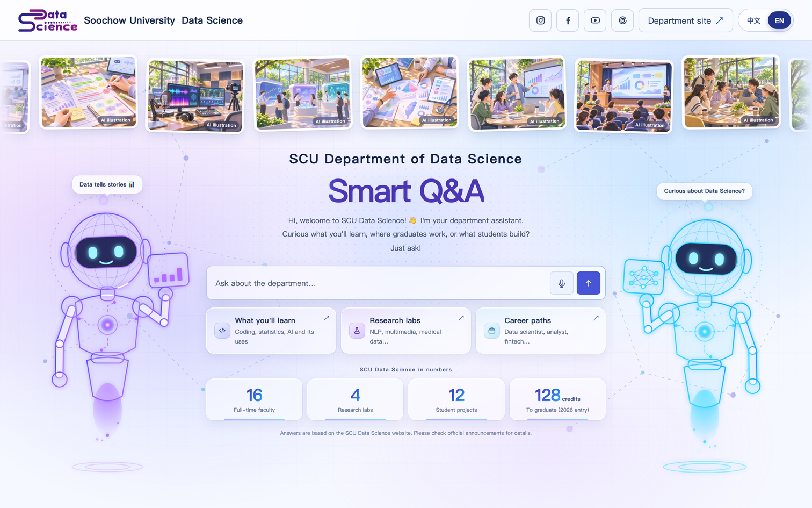
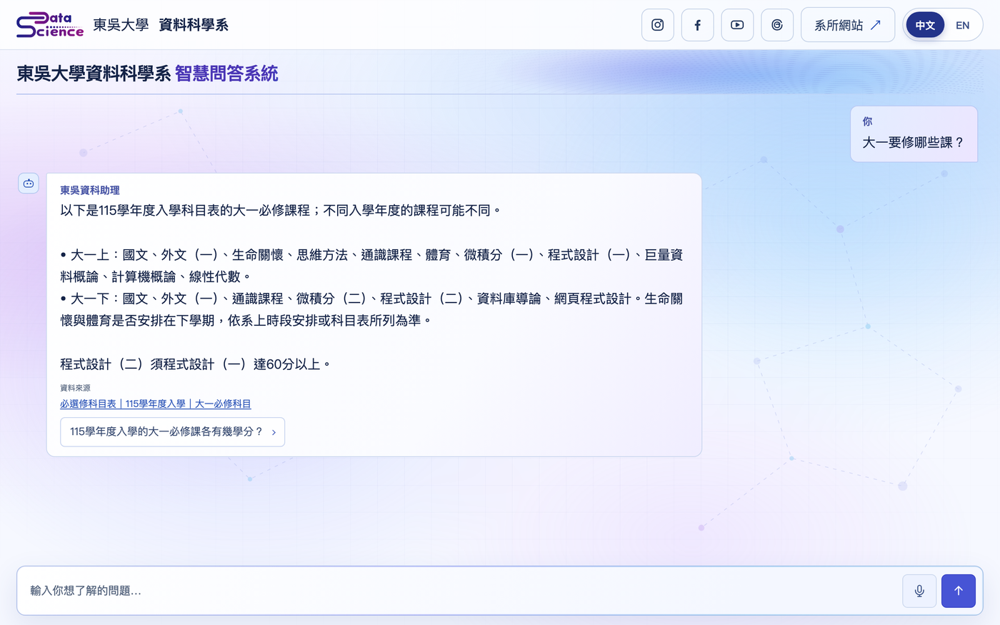
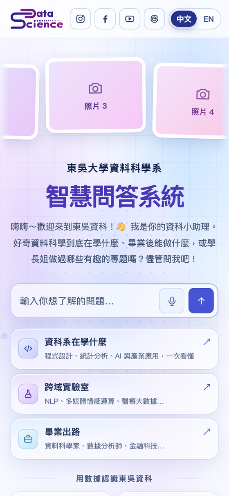
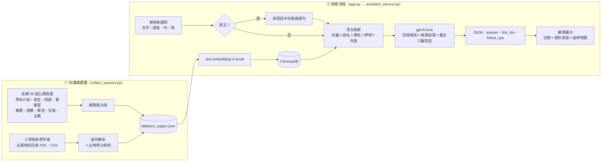

<div align="center">


# 東吳大學資料科學系 智慧問答系統

**SCU Data Science Smart Q&A — 讓高中生與家長用聊天的方式認識東吳資科**


</div>

---

## 📖 目錄

- [專案簡介](#-專案簡介)
- [功能亮點](#-功能亮點)
- [畫面展示](#-畫面展示)
- [系統架構](#-系統架構)
- [技術棧](#-技術棧)
- [專案結構](#-專案結構)
- [快速開始](#-快速開始)
- [更新系網資料](#-更新系網資料)
- [自訂與調整](#-自訂與調整)
- [API 說明](#-api-說明)
- [資料來源與限制](#-資料來源與限制)
- [安全注意事項](#-安全注意事項)

---

## 💡 專案簡介

高中生在選填志願時，常常想知道「資料科學系到底在學什麼？」「和資工、資管有什麼不同？」「畢業後能做什麼？」。這些答案其實都在系網上，但分散在學系介紹、課程資訊、考生常見問答等不同頁面，第一次逛系網的人不一定知道從哪裡找起。

本專案以**檢索增強生成（Retrieval-Augmented Generation, RAG）** 打造一個智慧問答助理：

1. 先把東吳大學資料科學系**官網的公開資料**整理成知識庫；
2. 使用者提問時，系統從知識庫找出最相關的段落；
3. 再由 GPT **只依據這些段落**整理出回答，並附上資料來源連結。

回答有憑有據、查不到就誠實說明，適合作為招生諮詢的輔助工具。

> 本專案為「生成式人工智慧」課程的期末專題，並非東吳大學官方系統。正式招生資訊請以[系網](https://web-ch.scu.edu.tw/datascience)與招生簡章為準。

---

## ✨ 功能亮點

### 🧠 問答核心
- **RAG 問答**：只依據系網資料回答，資料不足時明確說「無法確認」，不憑空編造。
- **附資料來源**：每則回答下方列出所依據的系網頁面；問到課程時直接附上該學年度的科目表 PDF。
- **理解追問**：保留最近三輪對話，例如問完「大一要修哪些課？」再問「那大二呢？」也能接得上。
- **延伸問題建議**：每次回答後提供 0～2 個「可以接著問」的問題，點一下就能繼續。
- **回答回饋**：每則回答下方有 👍👎 按鈕，紀錄存在 `feedback/feedback.jsonl`，執行 `python feedback_report.py` 可看統計與被按 👎 的問題。
- **結構化輸出**：模型以 JSON Schema 回傳 `answer`（正文）、`closing`（結語）、`link_ids`、`follow_ups`，網址由程式依段落 ID 還原，避免模型自行編造連結；結語獨立成欄位，確保每則回答都有自然的收尾。
- **Few-shot 範例**：回答前先給模型看 4 組示範問答（資料充足、是非題、資料只夠回答一部分、離題問題），中英文各一套，讓語氣與格式更一致。

### 🔍 混合檢索
- **向量語意搜尋**：OpenAI `text-embedding-3-small` + 本機 ChromaDB。
- **姓名比對**：問題提到老師姓名時，直接帶入該老師的資料。
- **列出全部**：問「有哪些實驗室／所有老師」時取出整頁資料，不會只列出一部分。
- **課名比對**：問題和課名有 3 個字以上相同時（例如「機器學習」），補進該課程所在的科目表段落。
- **學制與入學年度篩選**：科目表分學士班、碩士班、碩士在職專班，問題沒提到學制時以學士班回答；問題指定年度就用該年度，沒指定則用最新年度。

### 📚 科目表 PDF 解析
- 解析三個學制共 **16 份**必選修科目表：學士班 110～115、碩士班 111～115、碩士在職專班 111～115 學年度，整理每門課的選別、學分、開課學期與備註。
- 學士班依「入學年度 × 年級 × 必修／選修」分段；碩士班課程較少，必修、選修各整理成一段。
- **自動核對必修學分加總**是否等於 PDF 上的總計，16 份全部相符。
- 兩份只有掃描圖片的 PDF（碩士在職專班 111、112 學年度）改用人工校對的文字版 CSV。

### 🌐 中英雙語
- 右上角一鍵切換 **中文／EN**，整個介面、機器人對話泡泡、錯誤訊息與語音輸入都會跟著切換。
- 英文模式下，系統先把問題轉成中文檢索系網資料，再**用英文回答**，並自動將民國學年度換算成西元。
- 選擇的語言會記在 Cookie 中，下次打開維持同一種語言。

### 🎙️ 語音輸入
- 按麥克風即可錄音（最長 30 秒），由 OpenAI `gpt-transcribe` 轉成文字，確認後再送出。

### 🎨 介面設計
- **照片影帶**：首頁上方的照片自動橫向循環滑動，滑到的照片會浮起放大。
- **霓虹線框 AI 機器人**：兩側各一隻用發光線條組成的機器人，會漂浮、眨眼、擺手，胸口能量核心脈動，全息螢幕顯示長條圖與神經網路，並輪流說話。
- **滑鼠光暈**：游標經過的地方會出現柔和光暈，背景網格跟著亮起。
- **科技感背景**：淡網格、流動的極光漸層、資料節點連線。
- **主題卡片與數據看板**：一鍵提問的主題卡片，以及從系網資料即時計算的師資、實驗室、專題、畢業學分數字。
- **打字機開場白、毛玻璃卡片**，並支援手機版與「減少動態效果」設定。

### ⚡ 效能
- **串流回答**：回答邊產生邊顯示，約 **1 秒**就開始出現文字，一般問題約 2 秒寫完。
- 模型推理強度設為 `none`：回答是整理檢索到的段落，不需要額外推理，設為 `none` 可以更快開始回答。
- 伺服器啟動時即在背景載入向量資料庫，第一位使用者不用多等。
- 未設定 API 金鑰時自動切換為**本機試跑模式**，用關鍵字比對顯示系網段落，不呼叫任何付費 API。

---

## 📸 畫面展示

| 首頁（中文） | 首頁（English） |
|:---:|:---:|
|  |  |

| 對話：課程查詢 | 手機版 |
|:---:|:---:|
|  |  |

> 首頁照片帶使用 AI 生成的示意插圖，每張右下角都標有「AI 示意圖」，並非實際校園照片。

---

## 🏗️ 系統架構



**一次問答的流程：**

1. 瀏覽器把問題、最近三輪對話和語言送到 `/api/ask/stream`。
2. 英文問題先改寫成中文檢索語句；中文追問則併入前一輪問答。
3. `retrieval.py` 以混合檢索取回 6 段最相關的系網段落；問「有哪些實驗室」這類列清單的問題，則取出整頁資料。
4. `assistant_service.py` 將回答規則、段落與對話交給 `gpt-6-luna`，要求以 JSON Schema 輸出。
5. 回答一邊產生一邊傳回網頁顯示；寫完後，程式把 `link_ids` 換成真正的網址，連同延伸問題一起送出。

---

## 🧰 技術棧

| 類別 | 技術 | 用途 |
|---|---|---|
| 後端 | Python 3.10+、Flask 3 | 網頁、問答 API、語音轉文字 API |
| 語言模型 | OpenAI `gpt-6-luna`（Responses API） | 依檢索段落生成回答、英文問題改寫 |
| 文字向量化 | OpenAI `text-embedding-3-small` | 段落與問題的語意向量 |
| 向量資料庫 | ChromaDB（本機） | 儲存向量並以餘弦相似度檢索 |
| 語音辨識 | OpenAI `gpt-transcribe` | 麥克風錄音轉文字 |
| 資料擷取 | requests、BeautifulSoup | 擷取系網公開頁面 |
| PDF 解析 | pdfplumber | 解析必選修科目表 |
| 前端 | HTML、CSS、原生 JavaScript | 介面、動畫、雙語、語音錄製 |

---

## 📁 專案結構

```text
scu_qa/
├── app.py                 # Flask 入口：首頁、/api/ask、/api/feedback、/api/transcribe、語言切換、數據看板
├── feedback_report.py     # 統計 👍👎 回饋，列出被按 👎 的問題
├── assistant_service.py   # 回答規則（System Prompt）、英文改寫、呼叫 GPT、整理來源連結
├── retrieval.py           # ChromaDB 向量索引與混合檢索、本機試跑搜尋
├── sources.py             # 載入知識庫段落
├── collect_sources.py     # 擷取系網資料、解析本機科目表，輸出 data/scu_pages.json
├── course_tables.py       # 科目表 PDF 解析與必修學分核對
├── tuition.py             # 學雜費收費標準 PDF 解析（只取資料科學系相關收費）
├── transcription.py       # 語音轉文字
├── ui_text.py             # 中英文介面文字（改文案只要改這裡）
├── data/
│   ├── scu_pages.json     # 知識庫：264 段系網、科目表與學雜費資料
│   ├── 必選修科目表/       # 各學制、各學年度的科目表 PDF（掃描檔另附文字版 CSV）
│   │   ├── 學士班/        # 110～115學年度.pdf
│   │   ├── 碩士班/        # 111～115學年度.pdf
│   │   └── 碩士在職專班/  # 111～115學年度.pdf、111／112學年度_文字版.csv
│   └── 學雜費/            # 學校會計室的學雜費收費標準一覽表（只放最新一年）
├── templates/
│   └── index.html         # 網頁模板
├── static/
│   ├── site.css           # 樣式與動畫
│   ├── chat.js            # 問答、打字機、數字跳動、滑鼠光暈、機器人對話泡泡
│   ├── voice.js           # 語音錄製
│   ├── img/               # Data Science 標誌
│   └── photos/            # 首頁照片帶（放入圖片即自動顯示）
├── docs/images/           # README 截圖
└── requirements.txt
```

**知識庫內容（共 264 段，來自系網 39 個頁面、16 份科目表與學校學雜費公告）**

系統會把每個頁面切成一小段一小段（每段約 600 字以內，例如一位老師、一題問答、一個年級的必修課），提問時只取出最相關的幾段交給 AI 回答。

| 類別 | 收錄頁面 | 段數 |
|---|---|---:|
| 課程與修課 | 必選修科目表（學士班、碩士班、碩士在職專班）、課程資訊、各學制常見問答、雙主修、輔系、專題實作規定與問答 | 141 |
| 師資與研究 | 專任師資、兼任師資、講座教授、跨域實驗室、研究設備 | 25 |
| 學生成果 | 學生專題影音、競賽成果 | 23 |
| 實習與出路 | 企業實習修課說明、實習時程、實習常見問答、畢業出路、系友專區、系友訪談 | 20 |
| 招生 | 考生常見問答、大學申請入學、大學繁星推薦 | 12 |
| 學習資源 | 智慧創新 AI 學習中心、NVIDIA 證照培訓、XR 虛實融合學習教室 | 12 |
| 認識學系 | 學系介紹、辦學理念、辦學特色 | 10 |
| 國際交流 | 國際交流（SJSU 合作）、赴外交換、交換學生心得 | 9 |
| 學生生活 | 獎助學金、校園生活、系辦聯絡資訊 | 8 |
| 學雜費 | 115 學年度學雜費收費標準（學士班、碩士班、碩士在職專班、宿舍與其他費用） | 4 |


---|---:|
| 必選修科目表：學士班（110～115 學年度） | 62 |
| 必選修科目表：碩士班（111～115 學年度） | 15 |
| 必選修科目表：碩士在職專班（111～115 學年度） | 15 |
| 必選修科目表說明頁（學士班、碩士班、碩士在職專班） | 6 |
| 專任師資 | 16 |
| 學生專題影音 | 12 |
| 考生常見問答 | 10 |
| 跨域實驗室 | 6 |
| 畢業出路 | 4 |
| 辦學特色 | 3 |
| 企業實習修課說明 | 2 |
| 大學申請入學、系辦聯絡資訊 | 各 1 |

---

## 🚀 快速開始

### 1. 下載專案並安裝套件

```bash
git clone https://github.com/wei4211/scu-qa.git
cd scu-qa
python3 -m venv .venv
source .venv/bin/activate          # Windows：.venv\Scripts\activate
pip install -r requirements.txt
```

### 2. 設定 OpenAI API 金鑰

在專案資料夾建立 `.env` 檔：

```env
OPENAI_API_KEY=你的金鑰
```

> 不設定金鑰也能啟動，系統會進入**本機試跑模式**：以關鍵字比對直接顯示系網段落，不呼叫 AI、不產生費用，但無法使用 GPT 回答與語音輸入。

### 3. 啟動

```bash
python app.py
```

打開瀏覽器前往 **http://127.0.0.1:5001**，英文版為 http://127.0.0.1:5001/?lang=en。

- 第一次啟動時會把系網段落向量化並存進 `.chroma/`，之後只會重算有變動的段落。
- 伺服器刻意只監聽本機（127.0.0.1），作為原型展示使用。
- 要改用其他連接埠：`PORT=8000 python app.py`。

---

## 🔄 更新系網資料

系網內容更新，或新學年度的科目表出來時：

1. 到系網「必選修科目表」頁面下載新的 PDF，依學制放進 `data/必選修科目表/<學制>/`，檔名為 `<學年度>學年度.pdf`，例如 `data/必選修科目表/學士班/116學年度.pdf`。
2. 重新擷取一次：

```bash
python collect_sources.py
```

程式會擷取系網各頁面、解析資料夾中的每一份科目表，最後顯示核對結果，例如：

```text
學士班 115學年度（115學年度.pdf）：10 段，66 門科目，必修 81/81 學分，相符
```

如果出現「不符」，代表科目表格式可能改變，需要檢查解析結果。完成後重新啟動 `app.py` 即可。

**學雜費**：每年到會計室[學雜費收費標準](https://finance.scu.edu.tw/node/49)下載最新的「學雜費收費標準一覽表」，存成 `data/學雜費/<學年度>學年度.pdf`，並刪掉舊的那份，再執行 `collect_sources.py`。

> **掃描版 PDF**：如果 PDF 只有圖片、沒有文字，程式讀不到內容。請在同一個資料夾放一份人工校對的 `<學年度>學年度_文字版.csv`，格式可參考 `碩士在職專班/111學年度_文字版.csv`，程式會優先讀取 CSV。

---

## 🛠️ 自訂與調整

### 照片帶
把圖片（`.jpg`、`.jpeg`、`.png`、`.webp`）放進 `static/photos/`，重新整理網頁就會自動出現，不用改程式。

- 依**檔名排序**，例如 `01_校園.png`、`02_電腦教室.png`。
- **檔名會成為圖片的替代文字**，請用內容命名。
- 建議放 8～10 張橫式 4:3 的圖片；少於 8 張時會自動重複排列。

### 介面文字與雙語
所有中英文文案都集中在 `ui_text.py`：開場白、主題卡片、數據看板標籤、機器人台詞、錯誤訊息等。

### 回答規則與模型
`assistant_service.py` 中可以調整：

| 設定 | 預設值 | 說明 |
|---|---|---|
| `MODEL` | `gpt-6-luna` | 生成回答的模型 |
| `REASONING_EFFORT` | `none` | 推理強度；調高會更慢 |
| `SYSTEM_PROMPT` | — | 回答規則，例如資料不足時如何說明、課程需註明入學年度 |

### 畫面縮放
電腦版（寬度 1024 以上）預設以 75% 呈現，可在 `static/site.css` 開頭附近調整：

```css
:root { --ui-zoom: .75; zoom: .75; }
```

兩個數字改成一樣的值即可，例如 `.8` 變大、`.7` 變小。

---

## 🔌 API 說明

### `POST /api/ask/stream`（網頁使用）

參數與 `/api/ask` 相同，回應為逐行 JSON（`application/x-ndjson`）：先是多個 `{"delta": "回答片段"}`，最後一行是 `{"result": {…}}`，內容與 `/api/ask` 的回應相同；發生錯誤時最後一行為 `{"error": "訊息"}`。

### `POST /api/ask`

```json
{
  "question": "大一要修哪些課？",
  "history": [{ "question": "前一題", "answer": "前一則回答" }],
  "lang": "zh"
}
```

| 欄位 | 說明 |
|---|---|
| `question` | 1～400 字 |
| `history` | 最多 3 輪；每則回答最多 1000 字 |
| `lang` | `zh` 或 `en` |

回應：

```json
{
  "answer": "大一主要在打基礎～……\n\n能慢慢把程式基礎練起來！",
  "links": [{ "title": "必選修科目表｜學士班｜115學年度入學｜大一必修科目", "url": "https://…pdf" }],
  "follow_ups": ["115學年度入學的大一必修課各有幾學分？"],
  "mode": "api"
}
```

`mode` 為 `api`（GPT 回答）或 `preview`（本機試跑）。

### `POST /api/feedback`

```json
{ "question": "畢業要幾學分？", "answer": "學士班 115 學年度入學的畢業學分共 128 學分……",
  "rating": "up", "sources": ["必選修科目表｜學士班｜115學年度入學｜畢業學分"], "lang": "zh" }
```

`rating` 為 `up` 或 `down`。只記錄時間、語言、評分、問題、回答與資料來源標題，不記錄 IP 或 Cookie。

### `POST /api/transcribe`

以 `multipart/form-data` 上傳 `audio`（webm／mp4／ogg，最大 2 MB），可附 `lang`。回傳 `{ "text": "辨識結果" }`。

---

## 📌 資料來源與限制

- **資料來源**：[東吳大學資料科學系官網](https://web-ch.scu.edu.tw/datascience)的公開頁面，以及各學年度必選修科目表。
- **時效性**：知識庫是擷取當下的快照，系網更新後需重新執行 `collect_sources.py`。
- **查不到的資訊**：當年度報名日期、實習職缺等系網沒有寫的內容，系統會說明無法確認。
- **學雜費**：依學校會計室公告的收費標準一覽表，金額皆為每學期，回答時會提醒以最新公告為準。
- **學生專題**：目前只收錄作品名稱與簡介，沒有解析影片內容。
- **對話紀錄**：只存在瀏覽器中，重新整理頁面就會清空；只有使用者按下 👍👎 的那則問答會存進 `feedback/`。
- **英文模式**：多一步問題改寫，回答約比中文晚 1 秒開始；資料來源連結的標題維持中文頁面名稱。

---

## 🔒 安全注意事項

- **`.env` 不會被上傳**：已列在 `.gitignore`，請勿把 API 金鑰寫進程式碼或 commit。
- **回饋紀錄不會被上傳**：`feedback/` 含使用者輸入的問題，也已列在 `.gitignore`。
- 若金鑰不小心外洩，請立即到 OpenAI 後台停用並更換。
- 前端一律以純文字顯示回答，避免 XSS；後端會檢查問題長度、對話格式與錄音大小。
- Data Science 標誌與系上相關內容屬東吳大學資料科學系所有，正式公開使用前請先取得同意。

---

<div align="center">

Made with 💜 for 東吳大學資料科學系

</div>
